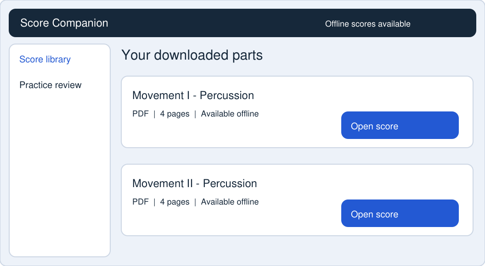
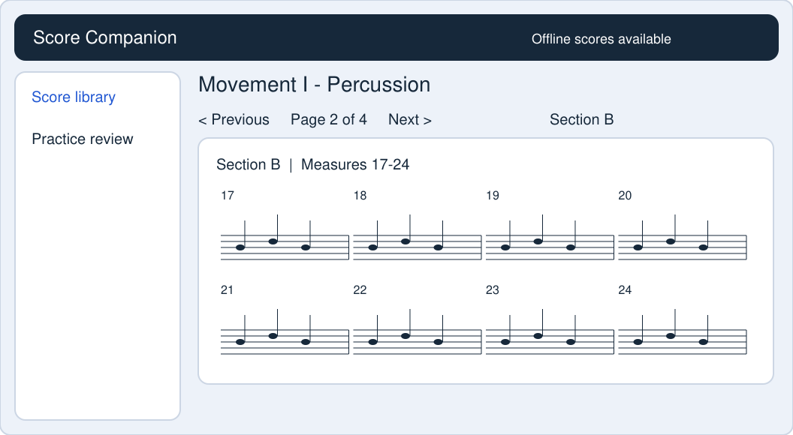
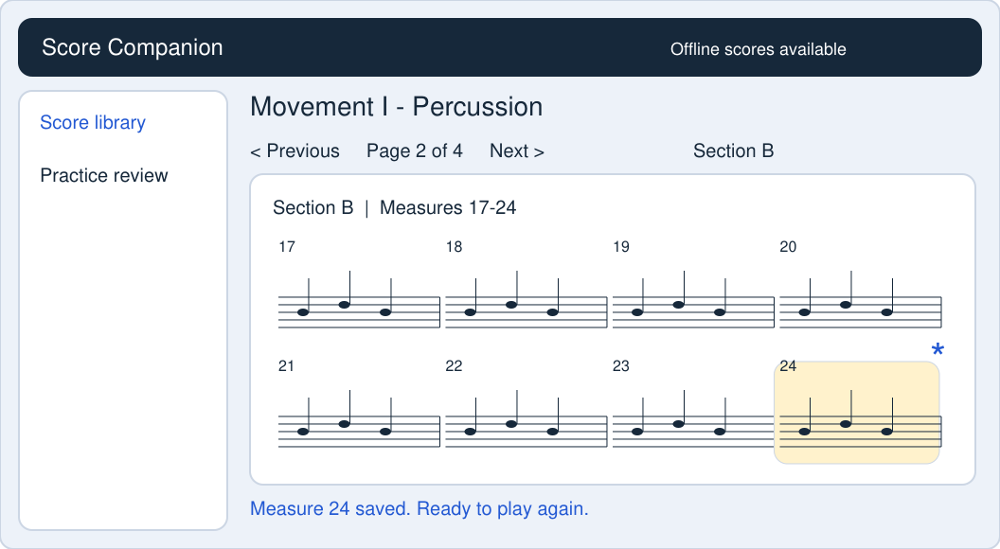
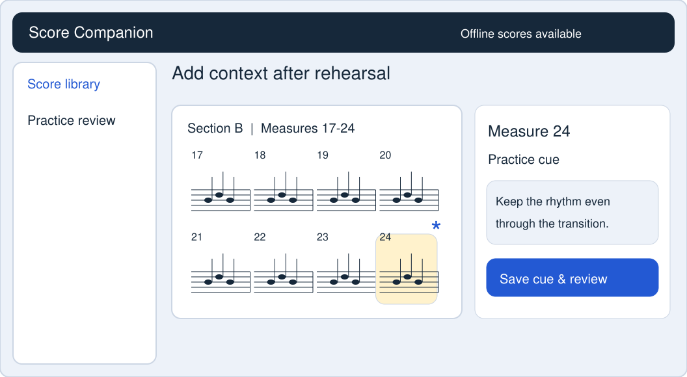
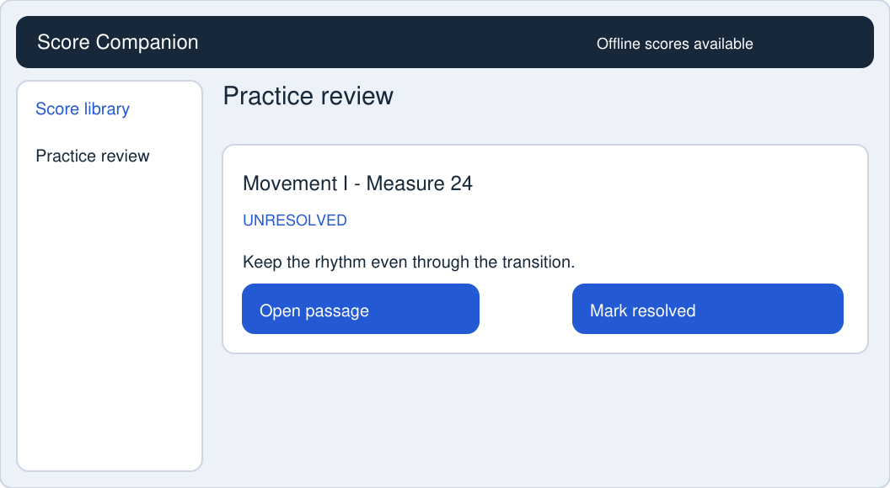
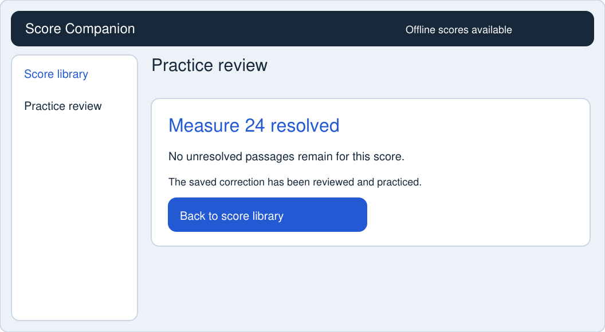

# Score Companion

A rehearsal score companion that helps musicians open downloaded parts, capture corrections quickly, and return to them for focused practice.

## Target behavioral segments
- Preparation-First Internalizers: prepare and practice until corrections become automatic.
- Reactive Score Annotators: preserve rehearsal corrections with contextual score marks.
- Format-Constrained Score Navigators: need reliable access, legibility, and efficient navigation.

## Critical moment
During rehearsal, the director gives a correction for a measure and restarts before the musician can write a full note. The musician needs to preserve the correction without missing the next entrance. Interview 7 directly supports this timing constraint.

## MVP features
1. Offline score library.
2. Uncluttered score viewer with page and section navigation.
3. One-action measure marker.
4. Measure-linked practice cue entered after immediate rehearsal pressure.
5. Unresolved-passage review with an explicit resolved action.

## Static prototype
[Annotated integrated screens](P7-Integrated-Screens.pdf) | [Full P#7 report](P7-Team08-Report.pdf)

Flow: open downloaded part > reach passage > tap measure to mark > add cue later > review and practice > mark resolved. The sixth screen is a completion state of feature 5, not a sixth feature.

### 1. Offline score library

### 2. Score viewer and navigation

### 3. One-action measure marker

### 4. Measure-linked practice cue

### 5. Unresolved-passage review

### 6. Correction resolved

## Contributions
| Code | Member | Contribution |
| --- | --- | --- |
| A | Matthew Pisani | Team planning synthesis, screen selection/integration, consistent redraws, explicit marker target, new resolved state, annotations, report and README assembly. |
| B | Logan Broussard | Hand-drawn personal-library, score-view and annotation concepts. |
| C | Ankit Joshi | Five-screen MVP flow, offline status, quick marker, deferred cue, unresolved review, and interview annotations. |
| D | Jonathan Dempsey | Hand-drawn library, score-view and page-indicator concepts. |

Original submissions are preserved in the report appendix. Final redraws credit the source concepts and integration separately.

## Scope and evidence
Every feature has an interview insight, segment, problem reduced and assumption in the report. Tuner, metronome, online browsing, export, account features, social chat and automatic error detection are outside this MVP.

These are static mockups with illustrative music and cue content. They do not implement offline storage, PDF handling or saved annotations. A timed rehearsal simulation and later cue-recall test are still needed.

## Project tracking
GitLab: https://gitlab.com/ull-gitlab/453/fa26/fa26-team-08/music-project

Milestone: P#7 - Rapid Prototyping. Issues #9-#16 track the work. The report records dates supported by the October 11 tracker snapshot and distinguishes later artifact preparation from unverified issue closures.

## Tools
Paper sketches; supplied PDF mockups; team interview and task documents; ChatGPT/Codex-assisted integration and ReportLab PDF generation.
